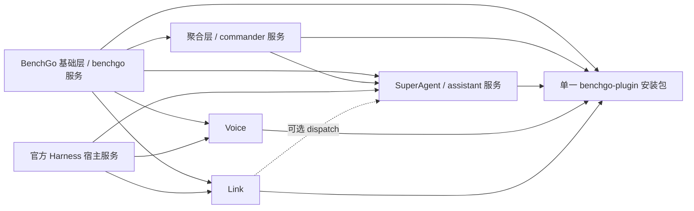

# BenchGo 源码架构

源码校对：2026-11-04。五源码包、独立入口与单一安装包已落地；下文 11-01/10-31 为历史实施记录，不代表本次重新执行。SuperAgent 现行目标及差距见[现状](../06-superagent/现状.md)和[首版验收缺口](../06-superagent/首版验收缺口.md)。

## 当前依赖与发布边界



实线从服务提供方指向依赖方（至安装包的线表示构建汇集）；Link 对助手是可选探测。官方 `agents/sessionQuery/llm/schedule/skills` 与自有 `commander` 聚合服务不同，SuperAgent 的 Worker 直接复用官方会话执行，并未再实现推理循环。公共前端复用 `plugins/shared/client/`，由唯一 `benchgo-plugin` 客户端装配。

当前仍有两处架构债务：SuperAgent 通过 `commander.store.directory` 取数据目录，尚未收敛到基础层公开 `benchgo.directory`；Worker 仍注入完整档案/记忆，尚未按任务包收窄。Goal 只投影工单结果与预算，不是第二套任务系统。内置提示词文件、关联调整单、语义查重与记忆直管等未完成项详见上述专题，不能用“五入口已落地”代表它们完成。

2026-11-04 遗留清理：Windows `afterPack` 改为读取安装包 exports 校验五入口和 runtime，移除迁移前的 Voice 路径；模块构建过滤备份/编辑器/补丁临时文件，保留源备份；npm 插件发布流程增加锁定依赖安装、`build:plus` 与发布闭包检查。定向验证见下方本次记录；实际 Windows 打包和 GitHub Actions 发布未执行。

## 本轮范围

保持一个 `benchgo-plugin` 安装包，将基础层、Harness 聚合、SuperAgent、Voice 与 Link 组织为五个源码包和五个 Cordis 入口，不引入额外常驻进程或独立安装流程。官方 `deepseek-harness/` 和 `reference/` 不修改；所有已有工作区修改随源码一起保留。

```text
plugins/
  benchgo/               基础层与唯一安装包 benchgo-plugin
    src/                 公共服务、配置、模型、统计、更新与插件装配
    client/              公共界面、侧栏及统一客户端装配
    shared/              跨模块复用的契约、HTTP 边界与工具
    test/                基础层及打包集成测试
    scripts/             模块与客户端构建
    lib/                 构建产物，不手工修改
      modules/           Harness、SuperAgent、Voice 发布源码及动态资源
      client.js          唯一注册 ID：benchgo-plugin
      link.mjs           Link 服务构建产物
      link-web/          Link 网页构建产物
  harness/               @benchgo/harness，Harness 聚合
    src/                 运行时、会话、委派、MCP、适配器与官方接入
    test/                原生运行时、协议夹具与集成测试
  superagent/            @benchgo/superagent，SuperAgent 总助手
    src/                 对话、任务、目标、记忆、媒体与后台工作器
    client/              对话、名片、档案、任务与产物界面
    test/                业务及界面测试
  voice/                 @benchgo/voice，语音服务、界面、协议与测试
  link/                  @benchgo/link，设备直连、移动界面与 Android
  shared/client/         跨包共享组件，不是安装包
```

模块内文件不重复业务前缀；总助手入口为 `plugins/superagent/src/plugin.mjs`，领域服务为 `src/service.mjs`，界面入口为 `client/index.jsx`。原生运行时及协议适配集中于 `plugins/harness/src/`。公共数据目录解析仍在 `plugins/benchgo/src/data-directory.mjs`，其余模块直接复用，不复制公共实现。

| 能力 | Cordis 导出 | 服务与依赖 |
| --- | --- | --- |
| 基础层 | `benchgo-plugin` | 提供 `benchgo` 公共服务；完整包根入口供官方发现统一客户端 |
| Harness 聚合 | `benchgo-plugin/harness-plugin` | 依赖基础层，提供 `commander` |
| SuperAgent | `benchgo-plugin/superagent-plugin` | 依赖基础层、`commander` 与官方会话能力，提供 `assistant` |
| Voice | `benchgo-plugin/voice-plugin` | 依赖基础层及官方相关服务，不硬依赖聚合运行时或总助手 |
| Link | `benchgo-plugin/link-plugin` | 依赖基础层及官方连接服务，可选消费 `assistant`，不硬依赖它或 `commander` |

DSH 中安装一个 BenchGo，详情按上述入口管理。子模块不可用时，公共界面按真实服务状态处理入口；关闭 Harness 聚合使依赖它的 SuperAgent 不可用，Voice 和 Link 的基础能力保持独立。关闭基础层会让依赖其服务的模块不可用。显式禁用状态应保留，不以默认值重新启用用户关闭的模块。

2026-11-01 客户端发现修正：基础层必须以完整包名 `benchgo-plugin` 注册，条目 ID 仍为 `commander`。此前基础层的子路径入口虽能解析后端，但不被官方 `clientModules` 识别为包含客户端的包，导致统一界面未加载。现行结构为一个包根入口加四个业务子入口；不新增客户端注册，不修改官方引擎。下文既有测试和重启记录保留，其结论不替代这次真实客户端加载验收。

## 职责与兼容边界

- Harness 聚合负责外部 Agent 与会话生命周期；SuperAgent 负责任务、对话与跟进，通过服务契约使用运行时；Link 不读助手私有存储。
- 基础入口不再直接装配全部业务。各入口拥有自己的工作器、事件、路由与资源释放；SuperAgent 停用释放其会话写入方、后台定时器与数据库，不删除持久化内容。已经委派给 Harness 的独立任务仍由运行时管理。
- 保留 `benchgo-plugin` 包名、`./runtime` 导出、`commander` 服务与配置键、CLI 兼容命令、`commander_*` / `assistant_*` 工具名、HTTP 路由、环境变量、界面标识和持久化数据格式。运行数据目录 `assistant/` 不更名；这些协议名不是多余的旧入口。
- MCP 桥随运行时迁移，启动脚本地址与 Pi 扩展资源地址必须指向实际新文件。OpenAPI 继续描述原协议，文件位置与设计引用同步迁移；不为源码改名新增协议别名。
- `build:modules` 将业务发布源码与动态资源生成到 `plugins/benchgo/lib/modules/`，同时按目标位置修正跨模块相对导入。公共代码留在包根，最终发布白名单不再携带包根业务源码目录。Link 继续沿用服务与网页构建，不需要安装同级源码才能运行。
- `npm run reload:plus` 重建业务模块、BenchGo 客户端与 Link 网页，不构建服务器种子、不重启 Web；浏览器需刷新。模块源文件、`import.meta.url` 动态资源和统一客户端均应通过既有开发同步流程载入。
- 不保留旧源码空壳或目录兼容链接。既有已安装副本不修改；源码运行链接如指向旧路径，应通过既有安装/开发同步流程更新，不修改官方源码。

## 验证要求

验证新路径导入与动态资源、原生协议夹具、总助手与 Voice、Link 接入、MCP 注册与调用契约、npm 打包白名单及脱离源码的入口加载。检查根目录与桌面/服务端路径消费者，执行 `npm run check` 和 `npm run reload:plus`（不构建服务器种子、不重启 Web、不启动图形应用）。按本次影响运行自有测试，保留并标明已有失败与未验证的真实设备/供应商边界。

源码结构完成不等于总助手完整产品目标交付；[总助手设计](../06-superagent/设计.md) 中尚待实现和验收的事项仍保留原状态。

## 2026-11-04 架构校对与遗留清理验证

- `npm run check` 通过，官方引擎仍为干净的既有 pin。
- 构建/打包定向 6/6 通过，覆盖当前五入口、缺入口拒绝、导入重定位、资源保留与备份过滤。
- `npm --prefix plugins/benchgo run build:modules` 成功；`package-layout.test.mjs` 发布闭包/MCP 验证 2/2。
- 在 `plugins/benchgo` 中执行 `npm pack --dry-run --ignore-scripts --json`，清单 513 文件、备份文件 0；四个原始用户备份仍保留。
- 发布工作流 YAML 和构建/校验/发布顺序静态检查通过；未执行远端 CI、Windows 完整打包、网页重建或运行实例验收。SuperAgent 业务定向测试仍有既有 reopen 失败，见[当前基线](../06-superagent/现状.md)，不能声称全部验收通过。

## 2026-11-01 历史已执行验证

- `npm --prefix plugins/superagent test`：114/114 通过，涵盖已有对话、任务、记忆与界面测试，以及新增的独立停用和语音可用性验证。
- `npm --prefix plugins/harness test`：73/73 通过。原生协议与服务集成测试均位于 `plugins/harness/test/`；Windows 夹具通过当前 Node 与显式参数启动，Store 子进程带共享源码解析器，不再依赖 `.mjs` 直接执行或隐式模块解析。未运行真实原生引擎测试。
- 服务测试使用真实官方 Harness/Cordis 服务：停用 SuperAgent 移除自身 5 条 HTTP 路由和运行时事件监听，官方 LLM 与 Voice 服务仍可用；保留的旧 dispatch 返回 `ASSISTANT_UNAVAILABLE`，重复资源释放安全。
- 兼容助手语音接口在 Voice 未启用或对应朗读开关关闭时返回 503 / `VOICE_UNAVAILABLE`；跨来源请求仍先通过公共同源边界检查。
- SuperAgent 服务与插件入口语法检查通过。最终基础层 324 通过／2 跳过，Voice 145 通过，Link 186 通过／10 项 Linux 专用集成跳过；五模块真实 Cordis 启停、单包安装升级及 MCP 均通过。最终 `reload:plus`、根 `check` 与差异检查通过。完整范围见 [验证记录](../../plugins/benchgo/VERIFICATION.md)，不引用下述历史数量作为本次通过证据。
- 未进行本次真实桌面安装、Android 设备、麦克风、供应商请求、服务器种子或远端发布验收。

## 2026-10-31 历史目录迁移验证

以下保留上一次迁移的原始结论，引用路径已按当前源码结构更新；不代表五入口拆分已经重复执行这些检查。

- `npm run check` 通过：官方子模块干净，仍为 `571902028a75c64c1d767f4ae5fd099485f0ddf0`；未更新引擎或依赖版本。
- `npm run reload:plus` 通过：BenchGo 客户端、Link 网页与内置服务产物重建成功。未重启 Web、启动图形应用或构建服务器种子；本项证明构建成功，不宣称既有运行实例已经切换源码路径。
- 桌面打包、开发同步、开发启动及打包配置测试 31/31 通过；开发同步覆盖新目录与 `./runtime` 导出，并保留安装配置及额外依赖/导出。
- BenchGo 通用测试、Harness 聚合测试、SuperAgent 测试、Voice 与 Link 合计 799 项：759 通过、38 失败、2 跳过。38 项失败均在迁移前取样中出现，无新增失败。初次取样时外围路径正在切换，`update-feed` 曾暂时无法导入；最终其 9 项测试全部执行通过，不将该中间状态计为原有业务问题。
- 新增 `test/package-layout.test.mjs` 两项通过：基于真实 npm 发布清单验证服务依赖闭包及 MCP、Pi 扩展、Voice worklet；实际启动 MCP 子进程验证 initialize、tools/list、ping、tools/call，保留 `commander_delegate` 与不透明模型 ID。
- 实际生成 npm 包（196 个文件）、解包到工作区外临时目录，只接入现有外部依赖后，成功加载插件、`benchgo-plugin/runtime` 与 Link 导出；无需同级 Link 源码。临时发行包不保留。
- 当前路径 `plugins/superagent/test/live-startup.mjs` 对应的检查当时使用隔离官方 Harness 与本机模拟模型通过：配置、固定主会话、历史、实际模型请求与官方工具注册正常。未调用真实供应商。
- 迁移映射逐文件核对无缺失；业务源码除路径外内容一致，保留原有未提交修改。BenchGo 与 Link 的 OpenAPI 和迁移前内容完全一致；源码目录调整没有改变 HTTP/MCP 协议。旧源码目录与冗余入口已移除。

### 历史存量失败边界

| 测试文件（均为 `.test.mjs`） | 失败数 |
| --- | ---: |
| Harness 聚合 `test/codex`、`commands`、`opencode` | 3 / 5 / 2 |
| BenchGo `test/cli`、`model-picker-ui`、`projects` | 1 / 4 / 1 |
| BenchGo `test/session-routes`、`tool-config`、`usage-import` | 1 / 1 / 2 |
| Voice `test/backend`、`realtime-transport` | 1 / 2 |
| Link `test/ip-certificate`、`relay-deployment` | 10 / 2 |
| Link `test/server-bootstrap`、`server-manager` | 1 / 2 |

上述失败涉及 Windows 执行夹具/环境、原有界面与配置断言，以及实时语音测试服务夹具等，未借结构迁移重写这些行为。真实桌面安装、Android 设备、真实供应商、服务器种子与远端发布不在本轮验证范围。
