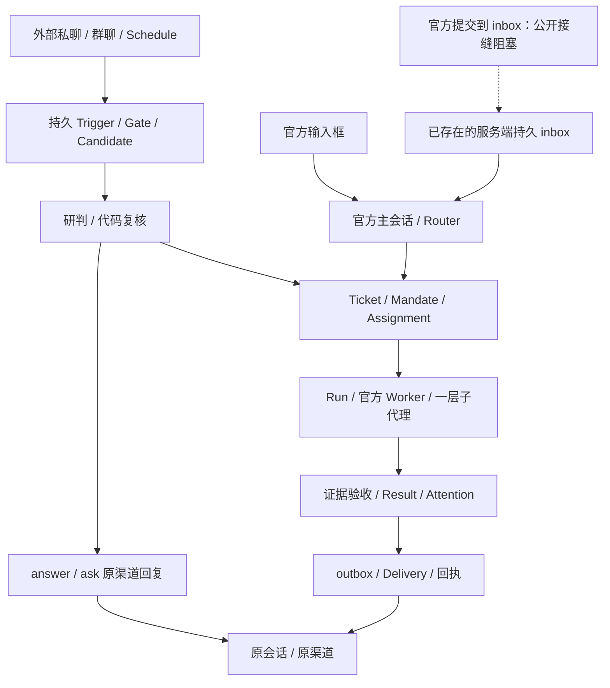

# SuperAgent：当前基线

核对日期：2026-11-05 晚。目标以[全链路架构](全链路架构.html)及[设计](设计.md)为准；开发顺序见[全链路对齐开发清单](全链路对齐开发清单.md)，缺口见[首版验收缺口](首版验收缺口.md)。代码、定向测试、构建、真实供应商/官方执行、真实渠道与用户视觉验收分别记录，不互相替代。今晚已实施多项 P1/P2 能力，但 P0 完整用户路径尚未通过。

## 1. 能力矩阵

| 领域 | 当前实现 | 验收边界 |
| --- | --- | --- |
| 单包与生命周期 | 五源码包、一个 `benchgo-plugin`，SuperAgent 使用 `benchgo-plugin/superagent-plugin` | 不修改官方/参考源码；真实安装另验 |
| 对话与持久入口 | 官方主/旁聊、普通 text 流式、QuietChat 发布投影、服务端持久 inbox 与逻辑会话归属 | 官方 composer 没有公开提交接缝；未挂载的自制输入与无效适配已清理，不能宣称桌面输入已接持久 inbox；真实输入/清空/重启待验 |
| 内置层与上下文 | `prompts/builtin-layer.md` 正文接官方 section（order -500），进入模块发布清单；冻结原文不改，模型投影清除 HTML 注释 | 内置文件初始化读取，重启加载；完整十项开局包、按需材料、旁聊自动摘要及 Worker 任务切片未整体验收 |
| 来源与准入 | Trigger/Gate/Eval/Decision、持久候选、来源去重；同 Trigger 工单唯一归属已补 | 外部私聊仍走候选。main 的 `desktop-owner`、桌面工具权限和私人上下文缺逐消息隔离，不能安全直达 Router |
| 工单编排 | 稳定短标题、目标/进展/卡点活摘要、Router 判重后代码复核来源/授权；completed 原单关账并新建关联调整单 | 定向已过；语义判重/合并/调整完整用户路径须独立真实证据，不把请求幂等当作语义查重 |
| 执行与隔离 | 官方 Harness、Run、worktree、租约/fence、检查点、原单续做、Worker 一层子代理与实时权限门 | 子代理问题/结果回父 Worker；真实外部副作用、完整账本及恢复仍须专项验收 |
| 证据与验收 | taskContract、零文件合法、证据来源元数据、可信已答上下文；review 独立超时、有限纠正、系统待核验 | 历史 no-files-09 和 fourteen-02 文本闭环通过；历史 Router/Worker 阻塞最终交付失败保留；今晚真实结果另记 |
| Attention | Worker self/default/user 分流，只能据原 Mandate 自答；权限/计划与未知问题交用户；官方 timed 问题 attachWait；多渠道问题/答案关联 | 混合批次、重启、原问题/版本/来源有受控覆盖；只暂停当前 Assignment，不宣称单 Assignment 子步骤独立推进 |
| 交付与恢复 | Router 自然正文和系统状态分开；确定未发可退避重试，未知保持 uncertain；主人核实留证、尝试次数 CAS、成功分片不整条重投 | HTTP 核实不向模型开放；不能重跑 Worker 或修改原结果；真实平台发送及核实仍待 |
| 等待界面 | 主聊天、工单和活动详情显示当前结果/问题/原因与下一步；定时系统卡可定位工单 | 今晚 87 个不同功能用例通过，含四态；用户免本轮视觉校验，真实桌面用户路径仍待 |
| 记忆与技能 | 既有直写基线保留；正式 UUID、候选双向关联、旧 ID 迁移、原文来源、版本链、清洗投影、来源/版本时间线已补 | 记忆无需逐条确认或专门工单；完整回滚界面待补，自建技能仍按候选批准边界 |
| 定时 | 复用官方 Schedule；created/triggered/completed/failed 持久系统卡，来源会话和机器 Trigger 校验，幂等恢复投影 | 官方 Host 实际到点受控通过，模型请求 0；真实主聊/完整重启及供应商执行另验 |
| 用量（预算已拆除） | token/请求用量记录与展示，不拦截执行 | 2026-11-06 决策：预算闸门整体拆除：原版无预算概念且会打断长任务，执行时长/Goal 预算与补时移除，金额预算结案 |
| 三角色模型 | Router `models`、Worker `workerModels`、辅助 `auxiliary`；精确 ID、显式优先、单项保存保留其他配置；Worker 缺省继承 Router | 72 个不同模型用例通过；普通 Router fallback 两条旧用例补齐 contextWindow 后行为通过，但既有 Object.assign(activeSelection) 修改官方 Readonly 选择仍属未解决的公开契约兼容阻点；真实三角色请求及密钥池职责未整体验收 |
| Voice/保险库/连接 | Voice 正式 publication 朗读、保险库句柄/固定目标/脱敏、十渠道及引用式凭据基线保留 | 本轮未做真实麦克风、目标服务、平台认证/收发或图标可用性完整验收 |

## 2. 架构边界与权威

- 所有能力仍通过现有五源码包交付一个插件。官方 Harness 提供 `ctx.agents`、`sessionQuery`、`llm`、Schedule、skills 和原始会话日志，不能都归为自有 `commander`。
- 默认数据根为 `~/.benchgo/assistant/`；`assistant.db` 是控制面，`ledger.db` 是检索账本；Goal 仅为目标记录，不另建执行系统（预算约束已于 2026-11-06 拆除）。`commander.store.directory` 的公开服务收敛仍是遗留项。
- Router 协调，环境操作从第一次探查即委派；卡片提问、定时、补充与修订工单由 Router 自主使用，工单修订不再额外弹审批（2026-11-06）；先持久 Ticket/Assignment，再登记 Run 和官方执行。结果须经证据验收，进程退出、模型返回或发送成功不独立表示完成。
- 来源、授权、策略、要求版本与 fence 由可信入口及执行门复核；未知外效保持 uncertain，不自动重放。停止、撤权和版本门优先于续做。
- 存储/冻结保留原始记忆及注释供定位、遗忘、并发与审计；只清洗送入模型的投影。来源摘录必须来自宿主核实的原用户文本，不以模型总结代替。
- 上游版本以根 `upstream.json` 为准，当前 `fcc0ad462172522aaf5c93a7b2e01f6b9f0b0159`（0.2.2-rc.1）。旧文档 `5719020…` 属历史验证版本，不能作为当前 pin。

## 3. 当前交付路径

该图表示装配，不表示每条用户路径已验收。外部私聊仍经候选，不能把 `engine.send` 的桌面主人入口用于外部消息。项目任务从提交态 HEAD 建 worktree，不包含源目录未提交修改；日常任务用独立 Worker 目录。交付前返工保留原单，交付后调整另建关联单。

## 4. 今晚定向验证与兼容阻点

| 范围 | 已报告结果 | 边界与来源 |
| --- | --- | --- |
| review 可用性与角色 | 核心 51/51；辅助/续审回归 28/28；review-continuation 12/12 | [review 记录](今晚-review-20261105.md)；各批重叠，不相加 |
| Worker Attention | helper/store 7/7；官方 Harness 4/4；同 Ticket 其他 Assignment 1/1；追加 prepend 官方 Host 顺序 8/8 | [Attention 记录](今晚-attention-20261105.md)，不是供应商最终闭环 |
| 渠道关联/发送恢复 | 101/101 | [渠道记录](今晚-channels-20261105.md)，受控传输，无真实平台发送 |
| 记忆 | memory/learning 26/26；memory-client 5/5；documents-ui 3/3 | [记忆记录](今晚-memory-20261105.md)，无真实模型/视觉验收 |
| 内置层与 Router 入口 | Engine 目标 6/6；发布 1/1；旧 JSONL 清洗 1/1；追加入口/恢复边界与旧 fallback 行为 5/5 | [engine 记录](今晚-engine-20261105.md)：公开 inbox beforeDispatch 用 agent.model.select 选新消息首项，冻结当轮队列，恢复保留旧模型；composer 绕开 inbox 不覆盖。旧 fallback 缺 contextWindow 夹具已补并通过，但既有 Object.assign(activeSelection) 仍违反公开 Readonly 契约，兼容未完成 |
| 定时/发布/服务 | 定向 42/42；实际 Harness service 1/1；官方 Schedule Host 1/1 | [生命周期记录](今晚-lifecycle-20261105.md)，到点模型请求 0 |
| 三角色模型 | 6 文件 72 个不同用例通过（原 70 + assessment 新增 2） | [模型记录](今晚-models-budget-20261105.md)，金额 unsupported；不覆盖上述 Router fallback 阻点 |
| API 契约 | superagent-openapi 17/17（原 10 + 新增 7），单独记录 | 模型/记忆/核实/定时/history/调整单公开契约，与模型 72 不相加 |
| UI | 87 个不同用例，无跳过：函数/交互 82、bootstrap 3、真实 React/layout 2 | [UI 记录](今晚-ui-20261105.md)，含四态、定位与操作；用户免视觉校验 |
| 工单/子代理/保护 | 首批 72 中 71 通过，Goal 旧 fixture 修后该 1 项通过；assignment 先前 5、本轮末 3；duplicate 1、官方 registry 1 通过；追加来源/新任务措辞及相邻回归 11/11 | [工单记录](今晚-tickets-20261105.md)，批次有重叠，不能相加冒充去重总量 |
| root 整合 | 首轮 23 项 16 通过；5 项旧 ctx.on fixture、2 项角色断言失败；修复后 runtime 2 + outbox 3、assignment 5 通过 | 首轮其余 11 项已过未重跑；不是“重新全跑 23 项全绿” |

本次晚间未执行全量测试。现存日志能核实历史 782/782、789/789、804/804、805/805；819/819 是旧文档声称工具输出、未落现存日志，820 是用户报告、无可核日志，不捏造统一数字。ticket-review 23/23、25/25 和联合 48/48 等为历史批次，不能当成今晚新增测试。详细来源见[P0 验收记录](P0验收记录.md)。

上轮 `npm run reload:plus` 已通过，日志为 `eval/superagent-evening-20261105/build-final-retry.log`，不覆盖随后 tickets/attention/engine 追加修复。本次新重建首次写 LICENSE 报 UNKNOWN；同命令重试已成功，日志 eval/superagent-evening-20261105/build-post-attention-engine-retry.log，首次失败保留；运行实例/真实请求仍须按对应场景证据判断。`npm run check` 上轮通过，只检查版本、工作区和入口一致性，不替代构建、运行或安装验收。

## 5. 真实验收与剩余门槛

历史真实 `routergo/deepseek-v4.1-flash` 的 Router 流式、`real-no-files-09` 零文件正文/三次同单返工/原聊最终回执、`real-fourteen-02` 14→9 条/已有 Result 后显式补时/原聊最终回执通过。首轮 no-files-01、旧 Router/Worker 阻塞失败与窗口不足记录保留，不能由成功场景覆盖。可信已答上下文修复与今晚 review 可用性修复仍须真实闭环证明。

晚间 `attention-1-attempt-1` 因发布后其他负责人仍有更新而被主代理要求中断；记录中的 `TypeError: fetch failed` 不可据此推断供应商或产品根因。结果为 fail、中断，非验收成功。隔离进程/目录已清理、主配置未变；最终重载后的 attention-1-attempt-2 也未通过：12 分钟窗口中官方 ask_user_question（timeout=-1）后 Attention/resolution=0，10 分钟额度到后 waiting、resultVersion=0、execution-budget/EXECUTION_EFFECTS_UNKNOWN；11 次实际流式请求均为 routergo/deepseek-v4.1-flash。源码诊断指向 api-remotes 全局问题 Gateway 顺序，尚无该场景运行时监听栈；官方 prepend:true 修复已落，官方 Host 顺序定向 8/8 通过，真实同阻点最后一次重试尚未启动（工具审批 429，待重试）。清理与主配置未变均已确认。今晚真实使用既有精确模型配置，辅助为 null；不把开发 Agent 模型要求写入产品配置。

尚需完成：Attention 连续三次端到端、首轮无 Result 恢复、真实暂停/恢复与关联调整、官方 composer 持久提交接缝和桌面重启、真实平台渠道、完整上下文/账本/回滚及 Key Pool 职责。金额预算及全部预算闸门已于 2026-11-06 结案拆除。所有真实场景及历史记录见[P0 验收记录](P0验收记录.md)。
