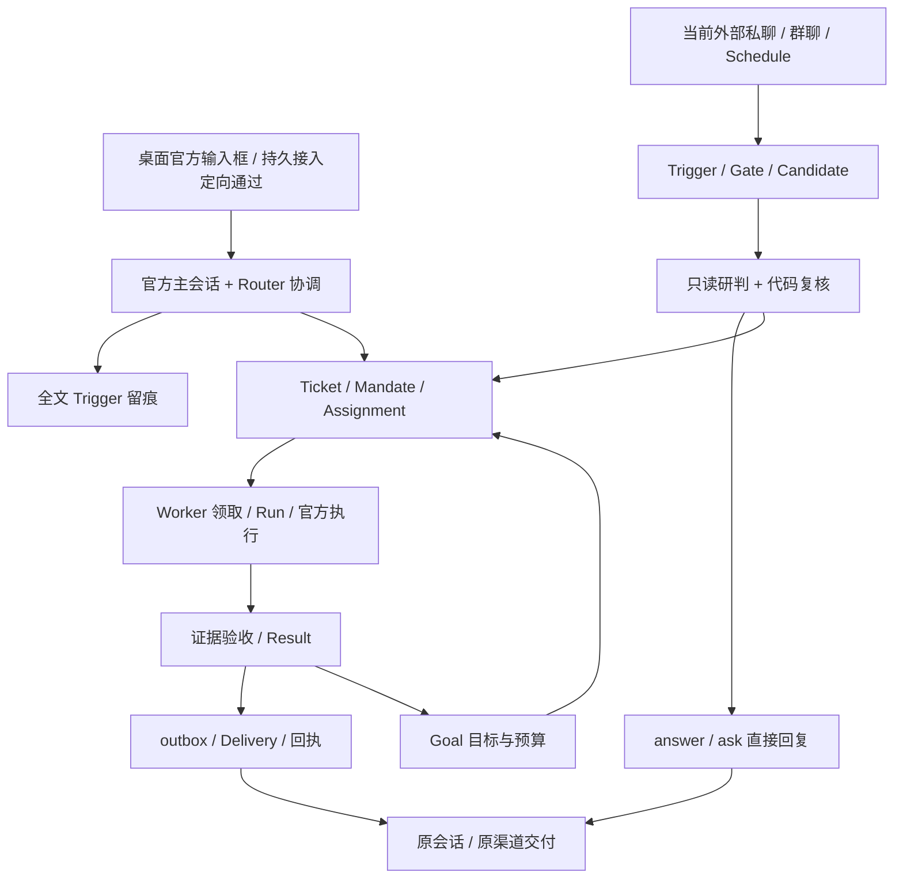

# SuperAgent：当前基线

核对日期：2026-11-05。以已商定的[全链路架构](全链路架构.html)为目标，对照当前工作树；优先完成主聊天，项目聊天押后。本页描述实现，不替代[设计](设计.md)。验收目标见[任务结果验收矩阵](任务结果验收矩阵.md)，实施顺序见[开发清单](全链路对齐开发清单.md)；代码存在、定向测试、构建和真实运行验收是不同状态。P0 正在集成，最新记录见 §6；P1/P2 仍待实施。

## 1. 能力矩阵

| 领域 | 当前基线 | 状态 |
| --- | --- | --- |
| 单包入口与生命周期 | `benchgo-plugin/superagent-plugin` 独立装配和释放 SuperAgent 服务 | 已接入 |
| 对话与上下文 | 官方主/旁聊、QuietChat 发布投影、五文件会话快照 | 桌面 composer 已接持久 inbox 与逻辑会话工单归属，定向通过；普通 Router 流式已过真实供应商验证，完整开局包仍待补 |
| 来源与准入 | Trigger、Gate、Eval、Decision、书面规则准入与来源事件去重 | 外部私聊当前仍走候选批次，未直达持久 Router；请求幂等不等于同 Trigger 唯一工单 |
| 工单编排 | Ticket、Mandate、Assignment、Subscription、Run、Result、Attention、Delivery | 独立短标题基础已落，完整任务正文保留；原单 reopen 仍存在，活摘要、语义查重、合并与关联调整单未完成 |
| 执行与隔离 | 官方 Harness Worker、worktree、租约与 fence、并发控制和检查点 | 已接入，外部副作用仍需核实 |
| 验收与交付 | Router 证据验收、结果与 outbox 原子提交、来源投递回执 | P0 已补 taskContract、零文件规则、自然报告、原成果续做及桌面/飞书 Review Attention；未知外部效果会阻止非只读续做。`real-no-files-09` 已通过零文件文本验收、三次原单返工和原聊天最终正文交付；`real-fourteen-02` 已通过 14→9 条原单修正、显式补时恢复与原聊最终交付。`real-current-router-block-12` 已答后沿原单续做，但 v3 review TIMEOUT、v4 重复询问同一阅读重点，最终 waiting，真实验收未通过；可信已答 Attention 缺失修复仅到代码与定向测试。`real-current-router-block-14` 无 Result，显式补时已排队，720 秒截止仍 open/resultVersion=0 |
| 连接与凭据 | 资源 → 接入 → 多平台，十渠道适配、引用式凭据、CAS 保存与状态 | 见[链接与渠道](链接与渠道.md)；真实认证/收发仍需验收 |
| 辅助能力 | vision、compression、summary、review 均有接线 | 看图/总结为服务和工具，不等于独立按钮或旁聊自动标题/摘要 |
| 记忆与技能 | 账本检索、计数器复盘、记忆直接写入与管理、自建技能候选发布 | 本次实现记忆免逐条确认、免专门工单；技能仍需批准，完整回滚界面待补 |
| 定时 | 宿主 schedule 四工具已接助手作用域；纯提醒可 answer，需要执行的进入 Ticket | 生命周期卡、真实重启恢复与供应商执行待验收 |
| 保险库 | 无口令、宿主管理密钥、加密存储、固定目标代填与脱敏结果 | 已实现；旧版本需重新录入，真实目标服务未验收 |
| Voice | 共享配置，朗读已识别正式 chat-publication 事件并去重 | 主聊天听写/通话及真实麦克风、供应商效果未由本次审计验收 |
| 预算与用量 | Ticket 绑定预算、请求预留、用量账本、预算等待与恢复 | 已接入，创建入口逐步开放 |
| 模型与密钥路由 | 主模型/辅助模型首选及备用队列，部分工单可显式指定工作模型 | 图中的三角色配置与密钥池职责尚未完整落实；旧 `keyPools` 已移除，不等于删除目标 |

## 2. 架构边界与权威

- 五个源码包只交付一个 `benchgo-plugin`，五个 Cordis 入口、一个客户端注册；Voice/Link 不硬依赖 SuperAgent 或聚合层，见[源码架构](../02-工作台与Agent/源码架构.md)。
- 官方宿主与聚合层不同：Worker 使用官方 `ctx.agents`、`sessionQuery`、`llm`；Schedule、skills、原始会话日志也是宿主能力，不能统称为自有 `commander` 提供。
- 默认数据根为 `~/.benchgo/assistant/`（本机默认为 `C:\Users\DraftGo\.benchgo\assistant\`，可使用配置目录）。`assistant.db` 承载控制面，`ledger.db` 承载检索账本；Goal 位于 `assistant_goals`，预算表为 `sa_goal_budgets`，不另建执行队列或状态权威。
- 环境操作统一通过 Ticket；Router 只协调，从第一次环境探查即委派，“直接探索 8 次”已过时。先持久化 Ticket/Assignment，Worker 领取后先登记 Run 再调用官方执行；模型配置等受控动作使用专属 `model-action` Assignment。
- 结果必须经过证据验收；模型返回、执行器空闲、进程退出和发送成功都不能单独表示完成。
- 纯文本任务没有文件产物也可完成；当前源码没有通用的“0 文件必失败”门禁。用户新闻示例暴露了验收加码及后续卡住的问题，不能据此宣称文本成果必须有文件。
- 暂停、停止、接管和恢复都先核实执行状态；未知外部效果保持 `uncertain`，不自动重放。
- 所有来源、授权、策略和要求版本由可信入口解析并在每一步复验；模型不能声明身份或扩大授权。
- 原始 Harness 日志是会话权威，SQLite 保存控制面、来源和可重建投影；Markdown 文档通过 hash/journal 保持一致。

## 3. 既有验证记录与边界

以下是此前校对/实施轮次留下的记录，本轮文档校对未重跑，不把同一天的历史数量当作本轮结果。

- 根 `npm run check` 通过：官方子模块干净，pin 为 `571902028a75c64c1d767f4ae5fd099485f0ddf0`。它不代表应用构建或运行成功。
- 核心契约定向测试 45 项：44 通过、1 失败；`ticket-revisions.test.mjs` 的 reopen 执行/验收/交付用例未观察到 `freshDelivery`，单独运行仍失败。作者说明此为既有失败；本次未确定根因，不宣称全量通过。
- 并行专题定向验证：渠道 42/42；记忆/学习/回复/验收与名片/宠物 69/69。批次有重叠，不相加为一次全量回归。
- 本次修正文档并清理打包/发布遗留：构建与打包定向 6/6，`build:modules` 成功，发布闭包/MCP 2/2，513 个发布文件中无备份。未完整构建应用、重启、启动图形应用或做四态视觉验收；不能据此断言定时与朗读修复已进入当前运行实例。真实模型、渠道、麦克风及恢复仍按[首版验收缺口](首版验收缺口.md)跟踪。
- 历史规模、全量测试和构建记录保留于专题文档，不作为本轮运行证据。首选/备用模型顺序故障切换已接入，旧凭据路由池实现已移除；架构图中密钥池的职责仍是待对齐目标。

## 4. 交付路径

上图只说明当前主要装配路径，不表示失败/阻塞已闭环。目标是用户主动输入登记全文后直达 Router，群聊等高噪声来源才筛选；当前外部私聊因 `routeDirect:true` 仍进入候选研判，这是差距。研判默认跟随主模型，配置辅助模型并勾选 `review` 才使用辅助模型。既有工单另有 attach/stop/revise/reopen，reopen 属于待替换的当前行为。

项目任务使用从提交态 HEAD 创建的 worktree，不包含源目录未提交修改；日常任务使用独立 Worker 目录，不是全部任务都创建 Git worktree。结果经过证据验收，Attention 与补充要求沿原工单处理，Delivery 回执与未知效果持久保存。

身份文档与配置兼容仍按《记忆与技能》中的身份权威流程处理；这属于配置兼容，不改变 Ticket 基线。

## 5. 关键架构缺口

以下是实现与现行目标的差距，不通过改写目标消除；证据与待验收项集中在[首版验收缺口](首版验收缺口.md)。

1. **内置层未接线**：`prompts/builtin-layer.md` 已形成，但引擎仍内联 section，构建清单也未包含 `prompts/`。
2. **Worker 上下文未收窄**：当前仍通过 `getSessionContext()` 注入完整五文件与有效记忆，而非仅任务包切片。现行权限和 fence 校验仍独立存在，不能据此直接断言权限越权。
3. **工单身份语义未对齐**：独立短标题已由统一 helper 归一为最多 10 个 Unicode 字符，完整目标/验收条件不截断；仍可原单 reopen，不同请求 ID 可为同一桌面 Trigger 再开单，活摘要、语义查重、合并与关联调整单待补。
4. **技能学习与完整回滚待补**：记忆本次改为直接生效，`assistant_memory` 不再经专门工单与逐条审批；自建技能仍需候选批准，完整记忆版本回滚界面尚未开放。
5. **开局包与子代理边界未完整落地**：对齐总结、关系索引和跨对话动态摘要未完整装配；官方子代理默认深度为 1，但产品级固定一层、逐层授权和结果归并仍需专项验收。
6. **集成仍有耦合**：SuperAgent 读取 `commander.store.directory`；桌面持久入口和清空后的逻辑会话工单归属已接入并有定向记录，真实桌面输入与重启路径尚待验收。构建备份泄漏、Windows 旧入口和 npm 发布前不构建的问题此前已清理，真实安装/CI 尚未验收。
7. **失败后续做已有真实文本闭环，其他路径待验收**：P0 已将 `failed/rework` 的自然说明与原 Assignment/Run/session/工作区续做提交接通，资源或无进展时保留等待，不以固定次数终单。核心定向与官方 Harness 原会话、真实 Git worktree/源目录未提交变更保留夹具已通过；`real-no-files-09` 真实供应商三次 rework 后仍沿原 Assignment/Run/session/工作区继续，最终 10 条零文件正文通过并回到原聊天。`real-fourteen-02` 首稿 14 条由真实 review 打回，同原单最终修正为 9 条，v8 passed/completed 并回到原聊；项目任务及其他真实路径仍须独立验收。
   真实新闻首轮 `real-no-files-01` 发现独立缺口：Worker 尚未提交结果便耗尽 10 分钟执行额度，Assignment 变为 uncertain、Ticket 保持 open/resultVersion=0，未告知或交付；12 分钟观察期限后判失败。deadline 的可恢复资源等待分支现已补代码和定向测试；真实首轮无 Result 的恢复仍需单独验收。`real-fourteen-02` 在 v6 记录 EXECUTION_BUDGET_EXHAUSTED 并送达系统等待，测试用户显式追加 600000ms、expectedResultVersion=6 后沿原 Assignment/Run/session/工作区继续，最终 v8 交付；这验证已有 Result 后的真实执行时长恢复，不覆盖首轮无 Result 的额度恢复，也不抹去首轮失败。
8. **阻塞链路真实验收未通过**：桌面/飞书已有持久 Review Attention、原问题/答案及可信 replyContext 的代码和定向记录，旧 `real-router-block-01` 曾局部验证 Attention 送达与答后同 Run 继续，但未完成最终交付。`real-router-block-03` 仅完成 14 条候选调查，Router v2 判 passed、Ticket=completed、Attention=0，用户未选择阅读重点；`real-worker-block-01` 原生 timed `ask_user_question` 返回 pending，未创建 Attention，未答却在候选阶段 v5 passed/completed。两者均真实验收失败。`real-current-router-block-11` 真实完成 Attention 送达、用户选择与原 Assignment/Run/session 续做，Worker 生成 v4 九条零文件摘要，但 Router TIMEOUT 后仍 waiting。`real-current-router-block-12` 同样已答后沿原 Ticket/Assignment/Run/session 续做，v3 成果核验 TIMEOUT，v4 又新建 Attention 重问同一阅读重点；最终 waiting/resultVersion=4，无 passed 正文。已发现并修复 review 输入未携带可信已答 Attention 的缺口，联合定向 48/48；修复后的真实闭环尚未通过。`real-current-router-block-14` 在 720 秒截止时仍 open/resultVersion=0、Attention=0；执行额度等待已通知，显式补时后恢复排队且 fence 1→2，但未产生 Result，不能据此推断具体原因。另一组 `real-retry-router-block-08` 与 `real-retry-worker-block-09` 仍保留无 Result 的历史失败。对应证据见[P0验收记录](P0验收记录.md)。内部 `review_wait` 不新增 Attention；`ticketRetryReview` unchanged 仍只表示原证据核验输入去重。
9. **交付与来源恢复不完整**：其他渠道的提问/引用回复关联、确定未发送与发送未知的分类及恢复仍列 P1。P0 已将合法 AI 正文与明确系统状态分开，部分替换后的发布和 UI 路径仍待集成验证。

## 6. P0 集成状态（2026-11-05）

| 范围 | 代码存在 / 集成状态 | 本地定向测试 | 真实验收 |
| --- | --- | --- | --- |
| 任务契约、文本验收、自然报告与系统状态 | taskContract、零文件规则、修正指令、AI 正文、blocked/review_wait 分流及原单续做已落代码；开单提示不凭空增加中间数量/阶段/交付物，未截断原文若被加新数字范围则任务目标和验收回退到原文；review 默认 maxTokens=12288，JSON 判别分支与解析契约对齐，诊断只透出安全错误码；Mandate 与 Worker 未决选择冲突时由 Router 二次生成判断，仍冲突则进入 review_wait | review 六组 53/53；研判/Goal 契约 13/13；writer 恢复 1/1；publicationContext 36/36；assessment 7/7；ticket-review 23/23；engine + Review Attention 79/79；最近一次源码全量 811 项中 809 通过、2 项并发时序/工作树波动单独重跑通过，不能记为全量全绿 | `real-no-files-09` 已通过：最终 10 条、checkpoint.files=0，v5 review=passed、Ticket=completed，原聊天最终正文与 outbox sent 回执一致；v1/v3/v4 为真实 rework，v2 review_wait 的系统状态已送达，无 Attention。05/06/07 失败历史保留 |
| Review Attention 与选项 | 问题/答案绑定原单及版本；可信答案恢复与显式补额度已有实现记录；未决选择冲突由 Router 二次生成判断，仍矛盾则内部 review_wait；最新修复把绑定当前 Ticket/要求版本/Run/session 的已答 Attention 传入 review 并纳入输入哈希，防止核验重试丢失答案；P0 仅桌面/飞书 | 前批 21/21；资源恢复相关 17/17；旧 ticket-review 23/23；最新 ticket-review、review-continuation、orchestration-runtime 联合 48/48，各批重叠不相加 | `real-current-router-block-12` 的首个 Attention 已 answered，原单续做后 v3 TIMEOUT、v4 新建 Attention 重问同一阅读重点；最终 waiting/resultVersion=4，无 passed 正文。可信已答上下文修复只有代码和定向记录，真实验收仍未通过。block-11 及其他旧失败保留；不能以续跑/生成摘要替代最终 passed 与原聊天正文回执 |
| 原成果自动续做与执行门禁 | 原 Assignment/Run/session/工作区、deadline 等待和显式额度恢复已落；未知外效时禁止所有非只读重放，允许只读核实 | 核心/旧契约相关 60 项；官方 Harness 原 session/deadline 6/6、未知工具日志 2/2；外效/权限/证据定向 34/34；runtime 12/12、重试 6/6，批次有重叠 | `real-no-files-09` 三次真实返工、中途 review_wait 恢复后通过。`real-fourteen-02` 14→9 条，v6 执行额度耗尽后显式补 600000ms，最终 v8 passed；保持同 Assignment/Run/session/工作区、fence 1→4，原转录前缀保留。`real-current-router-block-14` 的无 Result 执行额度等待已送达，显式补 600000ms 后 queued=true、fence 1→2，但截止仍 open/resultVersion=0，恢复后的最终交付未验收通过 |
| 等待状态与主聊天投影 | 三类等待、系统身份、问题答复、资源恢复及 inbox 回显/去重已落代码 | UI 相关 71/71；headless 浏览器功能 1/1，含四态/主题/宽度/键盘/停止 | 用户视觉验收未执行；GUI 截图按用户要求免验 |
| 桌面持久入口 | 官方 composer → engine.send；sessionLineage 保留清空后的原单管理，附件明确状态并保留草稿 | 收件/权限/控制 23/23；engine 目标 8/8；隐私清理 2/2 | 真实桌面输入与重启待验收 |
| Router 正式回复流式 | 普通 text 经官方实时事件流投影，过滤推理/工具参数，绑定原回合 | 流式/发布相关 22/22 | 已通过真实供应商场景；见下文证据 |
| 独立工单短标题 | 统一 helper，最多 10 个 Unicode 字符；不截断任务书或增加要求版本 | 标题/任务管理 8/8 | 基础能力已落；活摘要/语义查重仍属 P1 |

以上测试由对应实现任务报告，批次间可能重叠，不相加为全量数量。本轮 `npm.cmd run test:superagent` 全量 **819/819**；可信已答 Attention 修复的联合定向为 `ticket-review`、`review-continuation`、`orchestration-runtime` **48/48**，不替代真实验收。`assessment` **7/7**，数字范围守卫包含 2 个用例。最新修复后 `npm.cmd run reload:plus` 与 `npm.cmd run check` 均已通过，结果保留于本轮工具输出。真实 `routergo / deepseek-v4.1-flash` 经官方 loader 的 Router 流式场景通过：普通 text 增长 55 次，首段早于 committed end 2.103 秒，持久终答 325 字符，普通聊天未建票；证据见[原始记录](../../eval/superagent-p0-20261105/real-router-stream-01/router-stream-evidence.json)。`real-no-files-09` 已通过真实零文件交付、三次原单返工及原聊天最终正文回执；`real-fourteen-02` 已通过 14→9 条、已有 Result 后显式补时恢复与 v8 原聊正文交付。阻塞场景仍未真实验收通过：block-12 答后续做但 v4 重复提问；block-13 候选核验停在 review_wait；block-14 显式补时已排队但截止仍无 Result。真实渠道和桌面重启也待验收，P0 整体尚未完成。

### 续做保护增量（2026-11-05）

`ticket-review.mjs` 将未决选择识别收窄到明确的等待/提问及答后继续表达，避免仅因摘要引用一个问句而再次阻塞。若模型仍将这类中间结果判为 passed，Router 会基于完整 Mandate 与证据重新生成判断和问题；二次判断未能形成真实 blocked/ask 时转入 `USER_CONTINUATION_REVIEW_CONFLICT` 的内部 review_wait 自动重试。block-12 暴露出原保护并未给 review 模型完整可信的已答 Attention，v4 因而又询问同一阅读重点；现已补入当前 Ticket、要求版本、Run、session 绑定的已答问题/答案，并纳入 review 输入哈希。最新 `ticket-review`、`review-continuation`、`orchestration-runtime` 联合定向 48/48，仅证明代码和定向回归，真实阻塞闭环仍未通过。开单提示也明确禁止凭空增加中间数量、阶段或交付物，`assessment.test.mjs` 7/7，其中数字范围守卫为 2 个用例：移除未授权范围/阈值，并保留原文明确授权的条件。

真实 `real-continue-router-block-06`（180 秒）与 `real-continue-worker-block-03`（240 秒）均因 Worker/联网阶段未产出 Result 或 Attention 而超时；`real-final-router-block-07` 已完成 600 秒观察，Worker 产生候选 Result，但 Router 辅助核验连续出现 `TIMEOUT/AUXILIARY_QUALITY`，Ticket 停在 waiting、无 Attention/最终交付。三份证据均保留，不能标为通过。

后续 `real-current-router-block-13` 同样真实验收失败：Worker 已产出 8837 字符的候选阶段正文；v1/v2 review 连续 TIMEOUT，v3 为 AUXILIARY_QUALITY，均进入 review_wait。720 秒窗口结束时 Ticket=waiting/resultVersion=3、Attention=0，无最终 passed 正文。该记录作为历史失败独立保留，不改变其他场景结论；证据见[P0验收记录](P0验收记录.md)。

`real-current-router-block-12` 在用户回答后沿同一 Ticket/Assignment/Run/session 继续，v3 的 12625 字符成果 review TIMEOUT，v4 又新建 waiting Attention 重问同一阅读重点；首个 Attention 仍为 answered，最终 Ticket waiting/resultVersion=4。`real-current-router-block-14` 在 720 秒截止时 open/resultVersion=0、Attention=0；已送达 EXECUTION_BUDGET_EXHAUSTED 系统等待，测试用户显式增加 600000ms 后 queued=true、fence 1→2，仍未产生 Result。两场景均失败，不能将系统通知 sent 或恢复排队当作最终正文交付，也不从无 Result 推断具体根因；证据见[P0验收记录](P0验收记录.md)。

较早的第二轮全量 **782/782** 发生在新闻 deadline 后续修复之前，仅作为历史记录；review 输出额度及未知效果门禁源码全量 **804/804**、JSON envelope 与唯一对象解析源码全量 **805/805** 均有历史日志，提示/schema 修复后的 **808/808** 为上一轮工具输出记录。官方子模块 clean、pin 仍为 `571902028a75c64c1d767f4ae5fd099485f0ddf0`。05/06/07 均保留失败：06 最终 waiting/resultVersion=5；07 在 12 分钟观察期限后 waiting/resultVersion=4，含 INVALID_EVIDENCE_REQUEST、INVALID_EVIDENCE_PAGE、EVIDENCE_PENDING 和 REVIEW_UNAVAILABLE，无 passed 正文。09 则在同一要求版本下完成真实核验与原聊交付；独立隔离进程和临时目录均已清理，不覆盖旧失败。证据见[P0验收记录](P0验收记录.md)。

完整批次及真实场景状态见[P0 验收记录](P0验收记录.md)。记忆直写维持用户已完成的基线；P1/P2 未在本轮实施。新闻历史记录仅用于分析，不证明摘要内容真实，也未重跑旧工单。开发门槛见[全链路对齐开发清单](全链路对齐开发清单.md)。

